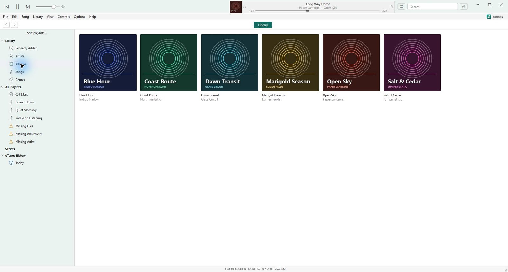

# oTunes

**Your music library, on your Windows PC.** Play the files you already own, browse your albums, and build playlists that stay with you when you move to TuneDeck.

[Download oTunes for Windows](https://github.com/PeteZDj/oTunes/releases/download/v0.1.0/oTunes-0.1.0-windows-x64.zip) · [Compare editions](#take-your-library-into-tunedeck)

## What you can do

- Play local music with a seek bar, volume, shuffle, repeat, a queue, and MiniPlayer.
- Browse album art or switch to a sortable song table. Search by song, artist, or album.
- Create playlists and smart playlists. Organize them in folders and show track counts.
- Edit track information and ratings, including metadata for multiple selected songs.
- Import an iTunes library XML file. Windows iTunes sync is a separate, optional workflow that requires desktop iTunes and Python.

## Screenshots

| Songs and playback | Album browsing |
| --- | --- |
|  |  |

## Install

Download the Windows x64 ZIP under **Releases**, extract the entire archive to a folder, and open **oTunes.exe**. Use **File → Add Folder to Library** to bring in music. You can also import an existing iTunes XML.

## Take your library into TuneDeck

oTunes is free. **TuneDeck** is the DJ edition, planned at **US$29 one time** for the packaged Windows build and updates to the purchased major version. It adds a DJ workspace, waveforms, hotcues, BPM and key analysis, energy, and EZRemix stem tools.

Both editions open the same local music library on the same Windows account. Your playlists, edits, ratings, and play counts carry over when you close one edition and open the other. DJ data stays available in TuneDeck. [AfroSoftware](https://afrosoftware.com/software)

## Source and license

oTunes is built in C++ and Qt on the Mixxx engine. The release includes the [corresponding source archive](https://github.com/PeteZDj/oTunes/releases/download/v0.1.0/otunes-tunedeck-corresponding-source.zip). Follow `CONTRIBUTING.md` in that archive, configure CMake with `-DTUNEDECK_LIBRARY_ONLY=ON`, and build target `mixxx`.

The application is distributed under GNU GPL version 2. See `LICENSE` and `COPYING` in the source archive.
