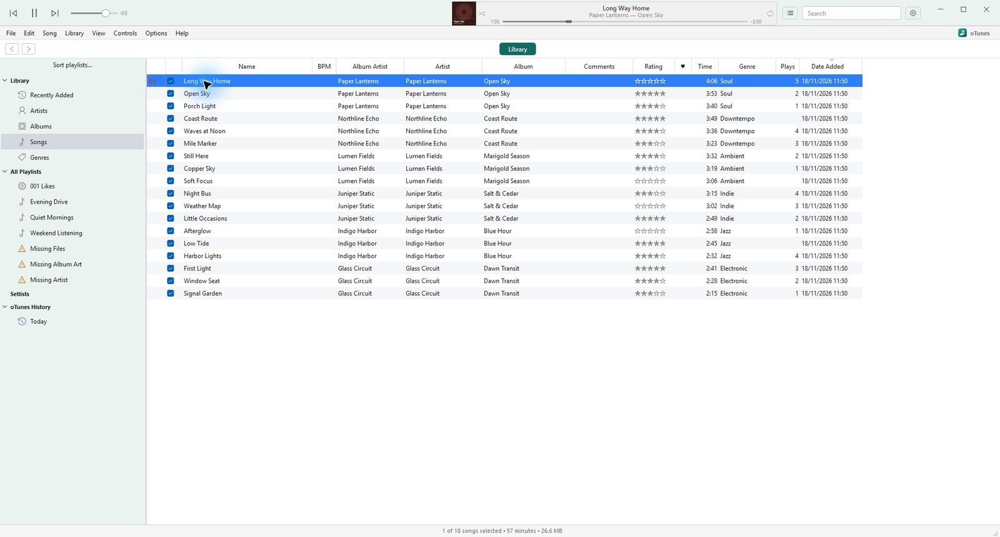
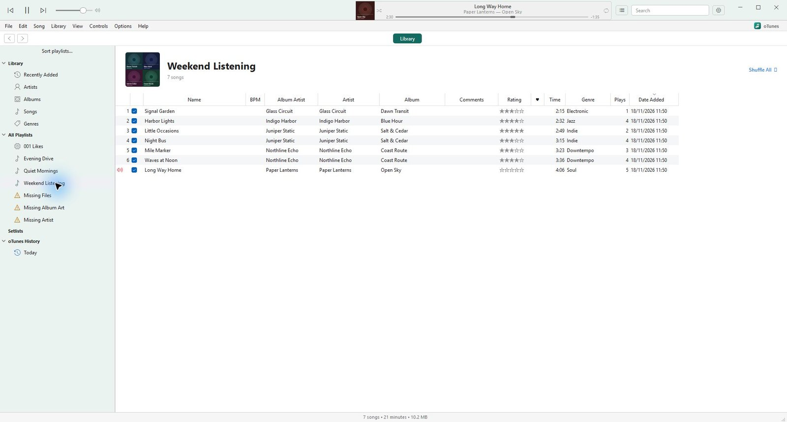
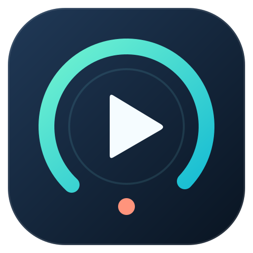
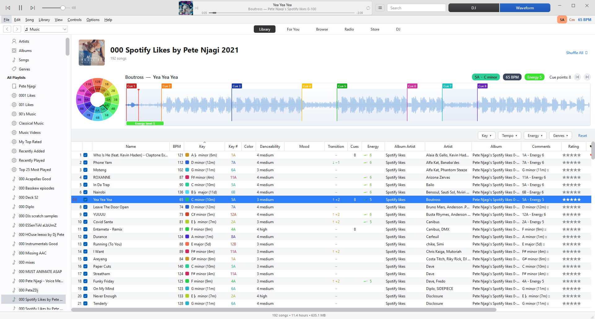
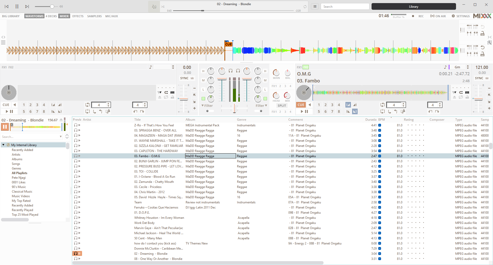
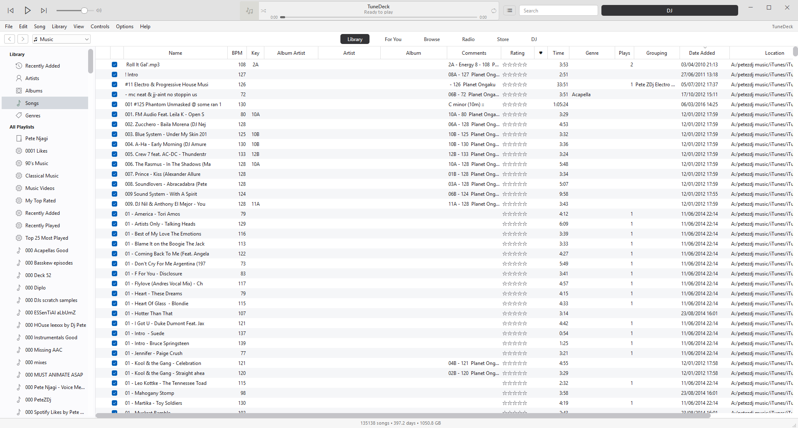
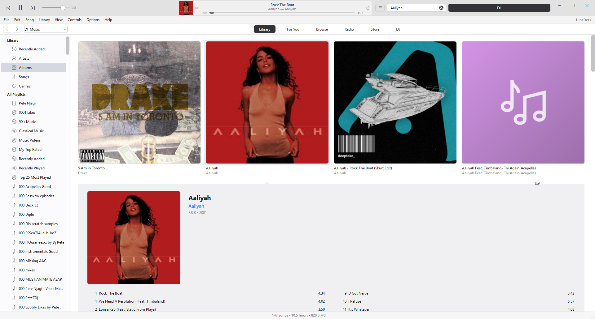

# oTunes

**A free Windows music player for the library you already have.** Browse your album art, build playlists, and keep your track information and ratings organized.

[Download oTunes for Windows](https://github.com/PeteZDj/oTunes/releases/download/v0.1.0/oTunes-0.1.0-windows-x64.zip) · [See the TuneDeck DJ upgrade](#tunedeck-upgrade)

| Songs and playback | Album browsing |
| --- | --- |
|  |  |

## What you can do in oTunes

- **Play your music.** Use the queue, MiniPlayer, shuffle, repeat, and playback controls.
- **Find any track.** Search by song, artist, or album, then browse cover art or sort the songs table.
- **Build your collection.** Create playlists and smart playlists, organize them in folders, and show track counts.
- **Edit tags and ratings.** Update track information one song at a time or select several to make a batch edit.
- **Bring your iTunes library.** Import an iTunes library XML. Optional Windows sync requires desktop iTunes and Python.

## Install on Windows

Download the [Windows x64 ZIP](https://github.com/PeteZDj/oTunes/releases/download/v0.1.0/oTunes-0.1.0-windows-x64.zip), extract the entire archive, and run **oTunes.exe**. Use **File → Add Folder to Library** to add music, or import an existing iTunes library XML. [Release notes and checksums](https://github.com/PeteZDj/oTunes/releases/tag/v0.1.0)

## TuneDeck · US$29 one time (planned)

**Take the collection you listen to into your next DJ set.** TuneDeck adds a waveform preview for preparing tracks and a full Mixxx-based DJ workspace for performing. The planned Windows upgrade includes updates to the purchased major version.

[Ask AfroSoftware about TuneDeck availability](mailto:team@afrosoftware.com?subject=TuneDeck%20Windows%20upgrade)

### See the track before you play it

Open **Waveform** to preview the whole track, jump to color-coded hotcues, and see BPM, musical key, and energy alongside the playlist. Filter by key, tempo, energy, or genre as you plan the next transition.

### Mix on the full DJ workspace

Switch to **DJ** for up to four decks, scrolling waveforms, EQ, effects, loops, and a mixer. Cue the next track in headphones, then bring it in with the mixer or a supported DJ controller.

### Prepare and organize your sets

- **Library and preparation.** Search tracks, browse cover art, edit tags in bulk, and organize playlists and nested setlists. Import iTunes XML or use optional Windows sync with desktop iTunes and Python.
- **Track analysis.** Scan individual tracks or entire playlists for BPM, musical key, energy, and suggested hotcues. Review and adjust cue placement before a set.
- **EZRemix.** Use the optional stem-analysis dependencies to prepare vocal, instrumental, and beat stems, then mix them independently.
- **Same collection as oTunes.** Open TuneDeck on the same Windows account to keep your playlists, metadata, ratings, and play counts. Close one edition before opening the other.

| TuneDeck music library | TuneDeck album browsing |
| --- | --- |
|  |  |

[View the original TuneDeck README gallery](screenshots/tunedeck-readme-reference.png)

## Source and license

oTunes is built in C++ and Qt on the Mixxx engine. The release includes the [corresponding source archive](https://github.com/PeteZDj/oTunes/releases/download/v0.1.0/otunes-tunedeck-corresponding-source.zip). Follow **CONTRIBUTING.md** in that archive, configure CMake with `-DTUNEDECK_LIBRARY_ONLY=ON`, and build target `mixxx`.

The application is distributed under GNU GPL version 2. See **LICENSE** and **COPYING** in the source archive.
